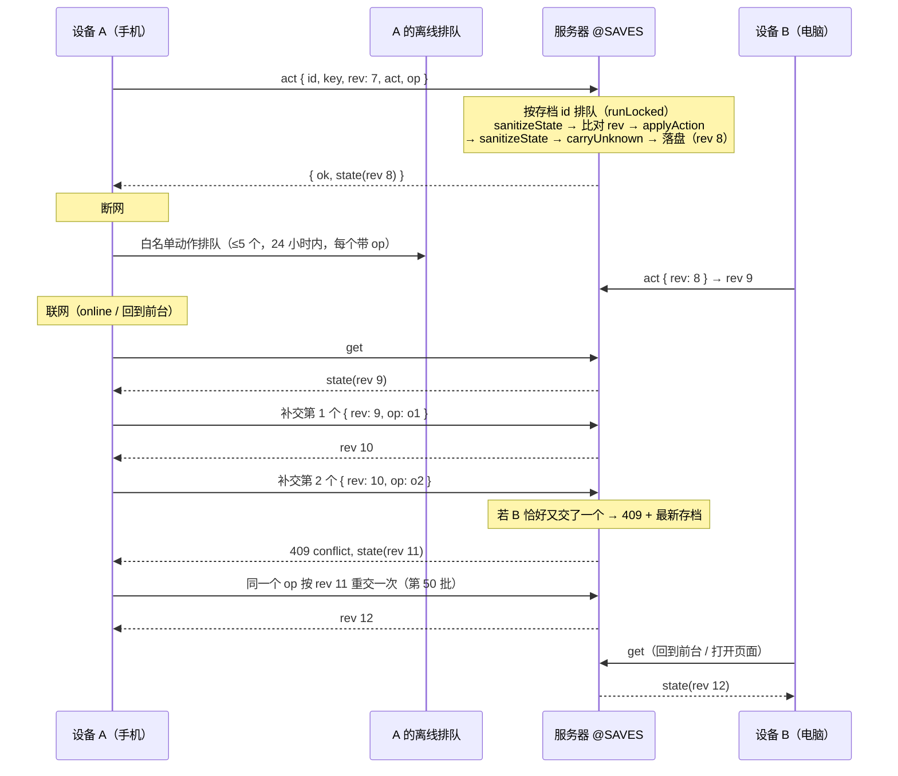

# 存档与多端同步：设计与审查（第 50 批，2026-11-20）

玩家的手机和电脑共用一份存档。本文写清存档从本机到服务器、再到其他设备的完整路径，各种异常怎么处理，
审查发现的问题（每条带复现条件）和修复，以及**各分支给 `PlayerState` 加字段时必须遵守的规范**（§5）。

相关代码：

| 位置 | 内容 |
| --- | --- |
| `src/game/server/world.ts` | Durable Object `EarthWorld`，保留实例 `@SAVES` 负责云存档：`handleSave`、`handleSaveLocked`、`persistMany`、`exportOf`、`deleteAccount` |
| `src/game/core/character.ts` | `sanitizeState()`：清洗不可信存档；`nextRev()`、`CAPS` |
| `src/game/core/save.ts` | 格式版本 `SAVE_VERSION`、迁移表 `MIGRATIONS`、`migrateSave()`、未知字段保留 `carryUnknown()`、`RETIRED_KEYS` |
| `src/game/ui/queue.ts` | 离线排队：`enqueue`、`parseQueue`、`flushSummary` |
| `src/game/ui/transfer.ts` | 同步码：`parseSyncCode`、`readSyncHash`、`hashAction`、`parseCred`、`parsePendingKey`、`exportName` |
| `src/pages/earth.astro` | 页面：`api`、`adopt`、`pullCloud`、`act`/`actOnce`/`flushQueue`、`restoreFrom`、`fromSyncLink`、`finishRekey`、`recode`、`exportSave`、`deleteAccount` |
| `tests/earth/save-sync.test.ts` | 本批的 core 和服务端测试；页面端测试在 `tests/earth/ui.test.ts` 末尾 |

## 1. 总体模型

**服务端权威。** 存档只存在服务器上，客户端从不上传存档，只上传「动作」（`act`），由服务器调用 `applyAction()` 结算后落盘。
本机的 `earth.save.v1` 只是最近一次服务器返回的存档的**显示缓存**，改了它没有任何作用。

本机存储（`localStorage`）：

| 键 | 内容 | 可信度 |
| --- | --- | --- |
| `earth.save.v1` | 存档显示缓存（`publicState`，种子为 0） | 不可信，读出后过 `sanitizeState` |
| `earth.cred.v1` | 凭证 `{ id, key }`，即同步码 `id.key` | 不可信，读出后过 `parseCred` |
| `earth.cred.next.v1` | 换码进行中的新凭证（第 50 批） | 不可信，过 `parsePendingKey`，只认同一个 id |
| `earth.queue.v1` | 离线排队 `{ id, items: [{ act, at, label, op }] }` | 不可信，过 `parseQueue`（重新校验动作、白名单、过期） |

服务器存储（`@SAVES` 实例）：

| 键 | 内容 |
| --- | --- |
| `save:<id>` | `{ keyHash: sha256(id:key), state, at }`；`state` 是清洗后的存档加上这版代码不认识的字段（§5） |
| `ops:<id>` | 最近 16 个动作编号和结果（去重用） |
| `rank:<h>` | 榜单记录（名字、形象、净资产），`h` = sha256(id) 前 12 位 |
| `h:<h>` | 哈希 → 真实 id（送礼找收件人用），只在服务端 |
| `notes:<地点>`、`notecd:<h>`、`notesday:<地点>` | 地点留言（作者记 `h`）和每日额度 |
| `week:<序号>` | 全服周目标累计数（匿名汇总） |

内存（实例重启即丢，不落盘）：每 IP 限流计数、共同事件大厅、送礼和二手摊挂单、在线频道的位置和聊天。

## 2. 数据流



文字版：

```
本机点按钮 ──act(rev, op)──▶ 服务器（按 id 串行）──▶ applyAction ──▶ 校验 ──▶ 落盘 save:<id>
   │                              │                                        │
   │ 断网                          └── rev 不对 → 409 + 最新存档             └──▶ 回复 publicState
   ▼                                                                             │
离线排队（≤5，24h）── 联网 ──▶ get 拉最新 ──▶ 按顺序补交（同一 op）──────────────┘
                                                                                 ▼
其他设备 ◀──── get（打开页面、回到前台、online、点「立即同步」、收到共同事件/交易提醒）
```

其他设备**不会**被推送存档变化：它们在下次 `get`（打开页面、切回前台、重新联网、动作时 409）时拿到最新进度。
在线频道（WebSocket）只广播位置、聊天、表情和「队伍/挂单有变化」的无内容提醒。

## 3. 各项设计

### 3.1 冲突处理（两台设备同时离线操作）

- **线性化**：同一存档的所有请求在服务器上排队执行（`runLocked`），不会出现两个请求读到同一份旧存档各写各的。
  共同事件、交易同时锁住涉及的所有存档。
- **乐观并发**：每个改存档的请求带客户端看到的 `rev`；和服务器不一致就不执行，回 409 并附最新存档。
- **不合并状态，重放意图**：两台设备离线时各自排的是「动作」而不是存档。联网后各自把动作按顺序交给服务器，
  服务器在最新存档上逐个重新结算（钱够不够、有没有事件挡着、时间对不对都重新判断）。所以不存在「两份存档怎么合并」的问题，
  代价是离线时预想的结果可能变（例如另一台设备已经把钱花了）。
- **补交时遇到冲突**（第 50 批）：冲突回复已经带回最新存档，用**同一个动作编号**按新版本重交一次（服务器按编号去重，不会做两遍）；
  同一个动作第二次冲突才算没通过、取消后面的。补交汇总里会写「期间另一台设备也有操作，N 个已按最新进度重交」。
- **玩家主动点的动作遇到冲突**：不自动重交，载入最新进度并提示「进度刚刚更新过……请再操作一次」，因为玩家是看着旧画面做的决定。
- **回复丢失**：动作编号 `op` 发出前生成，排队、重交都沿用；服务器记最近 16 个编号的结果，重复到达的不再执行（`dup: true`）。
  排队上限 5 个，远小于 16，不会因为记录被挤掉而重复结算。

### 3.2 版本号和回滚

存档里有两个「版本」，不要混淆：

| 字段 | 含义 | 谁改 |
| --- | --- | --- |
| `rev` | 写入计数，每次结算 +1（到 1e9 回到 0，`nextRev`） | 服务器每次落盘 |
| `v` | 存档**格式**版本（`SAVE_VERSION`，现在是 1） | 改了已有字段的形状时才加一（§5.3） |

- 客户端只用 `rev` 做两件事：发动作时带上（乐观并发）；判断「回来的存档正好是我这个动作的结果」（`state.rev === nextRev(before.rev)`）才显示数值变化。
  判断「有没有更新」用的是 `!==` 而不是 `>`，所以 `rev` 回绕或数据被回滚到更小的 `rev` 时客户端照样采用服务器的版本。
- **代码回滚**（正式环境切回旧版本、或切到另一个分支）：见 §5。读存档时比这版代码新的格式版本不判损坏（`migrateSave`），
  不认识的字段原样保留（`carryUnknown`），落盘时格式版本取较大的，不倒退。
- **数据回滚**（从 Durable Object 的时间点恢复，人工操作）：`ops:` 也回到旧时间点，玩家设备上那段时间之后排队、还没收到回复的动作可能再结算一次；
  恢复后客户端第一次 `get` 会载入回滚后的存档。恢复前应在更新日志里告知。

### 3.3 存档迁移（v1 → v2 的升级路径）

`sanitizeState()` 第一步调用 `migrateSave()`：

1. 没有 `v`、`v` 不是正整数 → 不是存档（`null`）。
2. `v < SAVE_VERSION` → 按 `MIGRATIONS[v]`、`MIGRATIONS[v+1]`…一步步升上来；缺任何一步 → `null`（宁可报损坏，不按错的格式读）。
3. `v > SAVE_VERSION` → 比这版代码新：不判损坏，按现在的格式尽量读。

升级到 v2 的做法和例子见 §5.3。服务端读到旧格式的存档时，第一次 `get` 就会把迁移后的结果写回（`migrated`），
之后不再重复迁移；客户端缓存里的旧格式存档同样在读出时迁移。

### 3.4 损坏恢复

| 损坏的地方 | 处理 |
| --- | --- |
| 本机存档缓存（`earth.save.v1`）坏了、没了、或是别的角色的 | **第 50 批**：凭证还在就用凭证从云端恢复（离线时等联网自动恢复），不再显示创建页。创建新角色前如果本机还存着凭证，先确认 |
| 本机凭证格式不对 | 当没有凭证（显示创建页，可用同步码恢复） |
| 本机排队坏了 | 逐条重新校验，坏的丢掉；过期的丢掉并提示 |
| 云端存档字段坏了（越界、未知 id、未来时间戳…） | `sanitizeState` 钳回合法范围，第一次读取时写回修好的版本 |
| 云端存档所在地点被删 | 挪到出生点，进度保留 |
| 云端存档结构坏了（不是对象、`id` 和存档键不一致——**第 50 批**新增这条检查） | 返回 500 `corrupt: true`，**原样留着不覆盖**（可人工从 Durable Object 时间点恢复），同 id 也不能重新创建 |
| 格式版本比代码新 | 不判损坏（§3.3） |

### 3.5 凭证泄露和更换同步码（第 50 批）

同步码 = `id.key`，等同于密码：拿到它就能在任何设备上玩这个角色。服务端只存 `sha256(id:key)`，比较用定长比较。

**更换同步码**（「我 · 设置 · 多设备同步 · 更换同步码」）：

1. 本机生成新 key，**先写进 `earth.cred.next.v1`**，再发 `rekey { id, key: 旧, newKey }`。
2. 服务器在存档锁里把 `keyHash` 换成新的；存档、`rev`、榜单都不变。旧码之后的所有请求都是 403 `badKey`。
3. 成功后本机改用新码，删掉 `next`，收起旧二维码。
4. **回复丢了**：本机还拿着旧码 + `next`。下次联网时 `pullCloud` 先用旧码重交 `rekey`（同一个 newKey）；
   服务器发现旧码不对、但 newKey 正好是现在的码 → 当成功（`dup: true`）。所以不会把自己锁在外面。
5. **两台设备同时换**：存档锁保证只有一个成功，另一个 403，它的 `next` 作废。
6. **其他设备**：下次请求得到 403 → 显示「同步码已失效」，不再发动作，排队的动作留着；输入新码（必须是同一个角色）后接着玩并补交。

换码不改 `id`。`id` 本身单独泄露（WebSocket 握手地址里有它）不能读写存档；
它只用来算在线状态和榜单的哈希，不广播。

### 3.6 删除账号和数据导出（第 50 批）

- **导出**（「我 · 设置 · 我的数据 · 导出存档」）：`export { id, key }` 返回服务器上这名玩家的全部数据——
  存档（含这版代码不认识的字段，种子清零）、自己贴的留言、榜单记录。**不含同步码和真实 id**（只放 id 哈希前缀 `player`），
  文件转给别人也拿不走角色。导出文件不能导入：服务端权威，客户端不能上传存档。
- **删除账号**：确认两次后发 `delete { id, key, confirm: 'delete' }`。服务器在存档锁里删除
  `save:`、`ops:`、`rank:`、`h:`、`notecd:`，从每个地点的留言里删掉自己的，撤下自己挂的和别人送给自己的挂单，退出共同事件队伍。
  本机随后清掉全部四个键并重新载入。删除后的同码请求都是 404；排在删除后面的动作不会把存档写回来。
- **删不掉的**：别的玩家存档里「常遇见的人」（`met`）记着你的名字、形象和 id 哈希前缀，那是对方的数据；
  全服周目标的累计数是匿名汇总。

### 3.7 隐私：存了哪些数据

| 数据 | 在哪里 | 谁能看到 |
| --- | --- | --- |
| 名字（≤12 字）、形象、出身、性格特质、全部游戏进度 | `save:` | 本人；名字和形象另外出现在榜单、留言、在线频道、共同事件、交易对方的「常遇见的人」里 |
| **最近一次真实定位**（`fix`，坐标保留 3 位小数约 100 米，加时间） | `save:` | 只有本人（不进榜单、不广播） |
| 真实地点动作的时间（`venueCd`）、打卡上班的地点和时间（`clockIn`）、当天真实上班分钟（`realWork`） | `save:` | 只有本人 |
| 净资产、游戏天数 | `rank:` | 所有人（榜单） |
| 留言内容、时间 | `notes:` | 同一地点的玩家 |
| 同步码 key | 只在本机和请求体里；服务器存哈希 | 本人 |
| 真实 id | 本机、请求体、WebSocket 握手地址、服务器存储 | 不广播；对外一律用哈希前缀 |
| IP | 只在内存限流表里，不落盘 | — |
| 聊天、在线位置 | 只在内存，不落盘 | 同区域在线玩家 |

### 3.8 配额和限流

| 项 | 限制 | 位置 |
| --- | --- | --- |
| 存档接口请求 | 每 IP 每分钟 90 次；IP 表超过 5000 条时**只清过期的**（第 50 批），清完还满就对新 IP 回 503 | `SAVE_LIMIT`、`handleSave` |
| 请求体 | 48 KB | `SAVE_BODY_MAX` |
| 同步码 | id 6–40 位、key 16–64 位字母数字；页面生成 24 位（约 123 bit） | `ID_RE`、`KEY_RE` |
| 离线排队 | 5 个、24 小时 | `QUEUE_MAX`、`QUEUE_TTL_MS` |
| 动作去重记录 | 每存档 16 个 | `OPS_KEEP` |
| 别的分支的未知字段 | 32 个、序列化后 16 KB，超了整批不带 | `FOREIGN_MAX_KEYS`、`FOREIGN_MAX_CHARS` |
| 在线频道 | 每区域 200 连接、每连接 5 秒 20 条、每条 1 KB、聊天 120 字 | `MAX_CONNS`、`MSG_LIMIT` |
| 留言、挂单、共同事件 | 见 `notes.ts`、`world.ts` 顶部常量 | — |
| Durable Object 单个值 | 平台上限 128 KiB；现在的存档远小于它（日志 40 条、各列表都有上限） | — |

## 4. 审查发现的问题

### 4.1 已修复（第 50 批）

| # | 问题 | 复现条件 | 修复 | 测试 |
| --- | --- | --- | --- | --- |
| 1 | **来回部署丢数据**：`sanitizeState` 只输出这版代码认识的字段，服务端每次结算都用它重写存档。任何分支推送都直接部署到正式环境，正式环境在各分支间来回切换 | 部署分支 A（存档加了 `pets`），玩家养宠物；再部署没有 `pets` 的分支 B，玩家做任意一个动作 → `pets` 从云端存档里消失；切回 A 宠物没了 | `carryUnknown()`：落盘时把原存档里不认识的顶层字段原样带上（有键名、个数、大小限制），发给客户端的仍只有认识的字段；比较「是否修过」时也按带上后的形式，不会每次读取都写盘 | `save-sync.test.ts`「来回部署」两条 |
| 2 | **新格式版本整份判损坏**：`sanitizeState` 要求 `v === 1`，否则 `null` | 某个部署把存档升到 `v: 2` 后回滚 → 服务器对这名玩家所有请求返回 500「云端存档已损坏」，玩家完全进不去 | `migrateSave()`：比这版代码新的版本按现在的格式尽量读，落盘时版本号不倒退；旧版本按迁移表升级 | 「存档版本」「存档迁移」 |
| 3 | **本机缓存坏了被当成新设备**：启动时缓存读不出来（或 id 对不上）就把凭证一起丢掉，显示创建页 | `earth.save.v1` 被写坏，或者新版本页面写了 `v: 2` 的缓存后正式环境切回旧版本 → 打开页面看到创建页；玩家点「开始生活」新建角色，`earth.cred.v1` 被覆盖，旧角色只能靠记下的同步码找回 | 凭证还在就自动从云端恢复（离线时联网后恢复）；新建角色前本机还存着凭证要确认；凭证本身用 `parseCred` 校验格式 | `ui.test.ts`「凭证在、本机缓存坏了」 |
| 4 | **删除本机存档不清排队** | 离线排了几个动作 → 「删除本机存档」→ 24 小时内用同一个同步码恢复 → 那几个动作被悄悄补交 | 删除本机存档、删除账号都清掉 `earth.save.v1`、`earth.cred.v1`、`earth.queue.v1`、`earth.cred.next.v1` | 「删除本机存档时排队的动作一起清掉」 |
| 5 | **限流表能被刷空**：IP 表超过 5000 条时整表 `clear()` | 攻击者用 5000 个不同 IP 各发一个请求 → 所有人的计数清零，正在被限流的 IP 立刻又能每分钟 90 次 | 先只删过期的；还满就对新 IP 回 503，已经在表里的照常计数 | 「限流」 |
| 6 | **补交遇到冲突全部取消** | 设备 A 离线排了 3 个动作；联网补交第 1 个之后、第 2 个之前，设备 B 做了一个动作 → 第 2 个 409，被当成「没通过」，第 2、3 个都取消 | 冲突时用同一个动作编号按最新版本重交一次；汇总里说明 | 「补交途中另一台设备动过存档」 |
| 7 | **同步码泄露后没有补救**：没有换码功能 | 同步码或二维码截图发给了别人 → 对方可以永久操作这个角色，本人除了放弃角色没有办法 | 「更换同步码」（§3.5），含回复丢失的补完、两台设备同时换、其他设备失效后输入新码 | 「更换同步码」三条（服务端）、两条（界面） |
| 8 | **不能删除账号、不能导出数据** | 玩家要求删除自己的数据或拿到副本 → 只能人工处理 | `delete`、`export`（§3.6） | 「导出」「删除账号」三条 |
| 9 | **存档 id 和键不一致时照常结算** | 存储里 `save:X` 的 `state.id` 因为人工修复出错变成 `Y` → 服务器照常结算，客户端 `adopt` 采用，页面缓存的 id 和凭证对不上，下次启动凭证被丢（问题 3） | 服务器把这种存档当损坏（500 `corrupt`，原样留着）；共同事件、交易读队友存档时同样检查 | 「损坏存档」 |
| 10 | **留言列表拉取失败时请求死循环**：`loadNotes` 失败时不记下地点，`renderPanel` 里的 `notesCard` 又立刻调它 | 在「今天」页时留言接口返回 429（限流）、403（同步码失效）、500，或断网 → 页面不停地重发留言请求（越被限流越发），手机发热耗电，服务器被自己的客户端刷 | 失败也记下这次试过的地点，30 秒后才重试；同步码失效时所有后台拉取都停 | 「留言列表拉取失败……不会立刻再拉」 |

### 4.1.1 变异检查

把每个修复逐个改回原来的写法（或删掉关键的一行），只跑对应的测试，确认测试会失败。脚本思路：替换一处源码 → `node --test --test-name-pattern=…` → 还原。
14 个变异全部被抓到：

| 变异 | 抓到它的测试 |
| --- | --- |
| 落盘不带未知字段（`persistMany` 只写 `x.state`） | 来回部署 |
| 比较「是否修过」时不带未知字段 | 来回部署（读取写盘次数） |
| 比这版代码新的格式版本判损坏 | 存档版本 |
| 不检查存档里的 id | 损坏存档 |
| 换码不认重交 | 更换同步码：回复丢了 |
| 限流表整表清空 | 限流 |
| 删除账号不删留言 | 删除账号 |
| 导出带真实 id | 导出 |
| 补交遇冲突不重交 | 界面：补交途中另一台设备动过存档 |
| 删除本机存档不清排队 | 界面：删除本机存档时排队的动作一起清掉 |
| 缓存坏了连凭证一起丢 | 界面：凭证在、本机缓存坏了 |
| 留言拉取失败不记地点 | 界面：留言列表拉取失败 |
| 换码前不先记新码 | 界面：更换同步码（回复丢了） |
| 同步码失效后不进入「输入新码」状态 | 界面：同步码在另一台设备换过 |

### 4.2 已知风险（没改，记下来）

| # | 风险 | 复现条件 / 影响 | 建议 |
| --- | --- | --- | --- |
| R1 | 每 IP 限流对共享出口不友好 | 学校、公司或运营商 NAT 后面多人一起玩，合计每分钟超过 90 次就互相限流 | 改成「每存档 + 每 IP」两层；需要看线上实际流量再定 |
| R2 | 没有账号数量上限 | 用脚本换 IP 大量 `create` → 存储无限增长；榜单缓存每次写入都作废，下一次看榜要 `list` 全部 `rank:` | 新建加单独的更严限流；榜单改成定期汇总 |
| R3 | 没有服务端存档备份 | 结构性损坏只能靠 Durable Object 时间点恢复（整实例回滚，会回滚所有人） | 每次落盘顺带留一份 `bak:<id>`（成本是写入量翻倍），或每天快照 |
| R4 | 同步码明文放在 `localStorage` | 页面一旦出现 XSS 就能读走凭证 | 现有措施：所有插值过 `esc()`；可以再加 CSP |
| R5 | 真实 id 出现在 WebSocket 握手地址里 | 可能进 Cloudflare 的请求日志；单独的 id 读写不了存档 | AGENTS.md 已允许；如要去掉，握手改为先发一条带 id 的消息 |
| R6 | 数据回滚后动作可能重复结算 | 见 §3.2 | 恢复前公告；恢复时保留 `ops:` 键的最新值 |
| R7 | 其他设备不会被推送存档变化 | 两台设备同时开着，另一台的画面要等切回前台或下次动作（409）才更新 | 可以在在线频道里给同一 id 哈希的其他连接发无内容的「存档变了」提醒（和共同事件提醒同一做法） |
| R8 | 未知字段只在服务端保留 | 新分支的字段在旧分支页面上不显示（预期如此）；客户端缓存也不带这些字段，但缓存只用于显示 | 无需处理 |

## 5. 给 PlayerState 加字段的规范（各分支必须遵守）

十多个分支在并行给 `PlayerState` 加字段（经济、房产车辆、属性公式、GPS 路线、宠物、任务成就……），而且**任何分支推送都会直接部署到正式环境**。
正式环境的代码会在这些分支之间来回切换，同一份存档会轮流被认识和不认识某个字段的代码读写。按下面的规则加字段，就不会丢数据、不会锁死玩家。

### 5.1 加一个新字段（最常见，不需要改格式版本）

1. **类型**：在 `core/types.ts` 的 `PlayerState` 里加字段，写清单位和取值范围。
2. **字段名**：ASCII 驼峰，满足 `/^[A-Za-z][A-Za-z0-9_]{0,39}$/`（见 `save.ts` 的 `FOREIGN_KEY`），**不能和任何分支已有或已删的字段重名**。
   不满足的话，在没有这个字段的代码上落盘时会被丢掉。
3. **新建角色**：`createCharacter()` 里给初始值。
4. **清洗**：在 `sanitizeState()` 的 `out` 里加一行，调用一个独立的 `cleanXxx(r.xxx, …)` 函数（像 `cleanTrails`、`cleanEstate` 那样），
   不要把逻辑直接写在 `out` 里——各分支只各加一行，合并时冲突最小。`cleanXxx` 必须：
   - **旧存档没有这个字段**时给默认值（不能返回 `null` 让整份存档判损坏）；
   - 对任何输入都不抛异常（`null`、数组、字符串、`NaN`、超大数字、原型链上的键）；
   - 数值钳到合法范围，列表、对象有条数上限，引用的 id 用已知清单过滤（参考 `knownList`）；
   - **幂等**：`sanitizeState(sanitizeState(x)) ` 和 `sanitizeState(x)` 一样（`server.test.ts`「落盘的存档永远是规范形式」会检查）；
   - 现实时间戳用 `opts.now` 拒绝未来时间（参考 `cleanReal`），游戏时间用存档的 `clock`。
5. **大小**：单个字段序列化后尽量在 4 KB 以内。所有「别的分支的字段」合计超过 16 KB（`FOREIGN_MAX_CHARS`）或超过 32 个时，
   在不认识它们的代码上会**整批**不带——一个分支塞太多数据会连累其他分支。
6. **不放秘密**：存档会经 `publicState()` 发给客户端。只给服务端用的值（类似 `seed`）要在 `publicState()` 里清掉。
7. **测试**：至少覆盖旧存档缺字段、各种坏值、幂等。不需要为「来回部署」单独写测试：只要字段名合规，`carryUnknown` 自动保证
   （`save-sync.test.ts`「来回部署」两条测的就是这件事）。

### 5.2 不要做的事

- **不要改已有字段的形状或含义**（比如把 `home` 从对象改成数组、把 `cash` 从元改成分）。旧代码会按旧形状清洗，把新形状的数据当坏数据清掉。
  需要改的话用「扩展—收缩」：加一个新字段 → 新旧两个字段都写一段时间 → 确认正式环境不会再切回只认旧字段的代码 → 删旧字段。
- **不要直接删字段**。删的时候把字段名加进 `save.ts` 的 `RETIRED_KEYS`，不然别的代码会把它当成「别的分支的新字段」一直带着。
- **不要为了加字段改 `SAVE_VERSION`**。加字段不需要；改了版本号反而让还没合并的分支读到「比自己新」的存档。
- **不要让客户端写存档**：新玩法通过新的 `GameAction` + `applyAction` 结算（AGENTS.md「权威结算」）。

### 5.3 确实要改格式时（v1 → v2）

只有改已有字段的形状、而又不能用扩展—收缩时才走这条路：

1. `save.ts`：`SAVE_VERSION = 2`；`MIGRATIONS[1] = (r) => ({ ...r, /* 把旧形状改成新形状 */ })`。迁移函数必须：
   - 纯函数、不改入参；
   - **幂等**：存档可能被旧代码碰过（回滚期间旧代码按 v2 尽量读、落盘时版本号保持 2），再次升级时可能遇到已经是新形状的数据；
   - 能处理字段缺失和坏值（迁移后还会再过 `sanitizeState`）。
2. 在 `save-sync.test.ts` 加测试：v1 存档迁移后的结果、重复迁移结果不变、迁移后过 `sanitizeState` 合格。
3. 合并到 main 前确认没有正在跑的旧分支部署：v2 存档在旧代码上能读（不判损坏），但旧代码会按 v1 形状清洗那个字段。

例子（假设要把 `vehicle: string` 改成 `vehicles: string[]`；这种情况其实更推荐扩展—收缩）：

```ts
export const SAVE_VERSION = 2;
export const MIGRATIONS = {
	1: (r) => ({ ...r, vehicles: Array.isArray(r.vehicles) ? r.vehicles : r.vehicle && r.vehicle !== 'none' ? [r.vehicle] : [] }),
};
```

### 5.4 检查清单（提 PR 前）

- [ ] 字段名合规、不重名
- [ ] `createCharacter` 有初始值，`sanitizeState` 有一行 `cleanXxx`
- [ ] 旧存档缺字段、坏值、幂等都有测试
- [ ] 没改已有字段的形状；删的字段登记了 `RETIRED_KEYS`
- [ ] 没改 `SAVE_VERSION`（除非走 §5.3）
- [ ] 没有新的客户端写存档的途径
