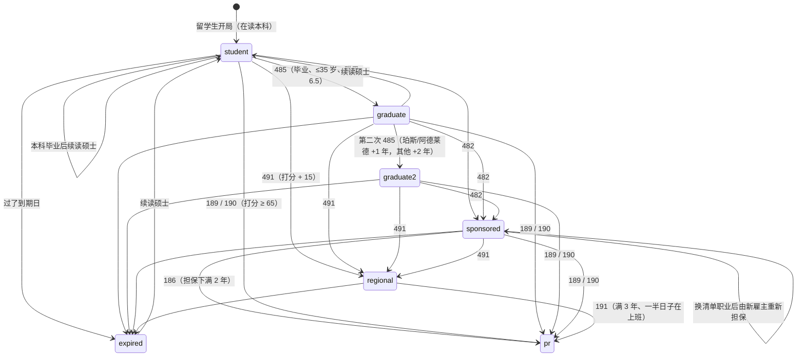

# 签证路线：设计与第一版（第 43 批，2026-11-20）

> **以官方为准、游戏简化，不是移民建议。** 本文和游戏里的签证规则只是把澳大利亚内政部（Home Affairs，immi.homeaffairs.gov.au）公开的规定压缩成玩法，
> 时间、费用、几率都是游戏自定的；真实申请请看 Home Affairs 官网或咨询注册移民代理（MARA）。

分支 `claude/earth-visa`，从 main `4f9c9e5` 开出；2026-11-21 合并 main `9029ca1`，更新日志改为 v70。合并时做的事见第 11 节。

## 0. 一句话

留学生出身开局持**学生签证（500）**在读本科；毕业后走 **485 毕业生签证** 过渡，再从三条路里选一条拿 **PR**：
雇主担保（482 → 186）、技术移民打分（189 / 190）、偏远地区（491 → 191）。签证会到期，到期前提醒，过期不能工作，可以续读硕士重新拿学生签。

## 1. 现状和新提议

| 内容 | 状态 | 在哪 |
| --- | --- | --- |
| 留学生出身（`origin: 'student'`）：现金 $1,200、二手车、魅力 30 | **现状**（main） | `core/character.ts` 的 `ORIGINS` |
| 留学生和别的出身打工没区别，没有签证概念 | **现状**（main） | — |
| 学生签证工时 48 小时 / 14 天，只在「在读学历课程」时限制 | **已在 main**（education-career，用户 11-20 已定「在读才限」；合并后改成「持学生签证并且在读」，见 §3.7） | 那边的 `core/visa.ts`、`data/education.ts` 的 `VISA` |
| 学历课程（报名、上课、毕业拿学历） | **已在 main**：同上 | 那边的 `core/education.ts` |
| 签证状态、到期、续签、485 / 482 / 186 / 189 / 190 / 491 / 191、技术移民打分、雅思、偏远地区类别 | **本批新提议，已落地第一版** | 本文第 3–6 节 |
| 工时限制和本批签证状态联动 | **合并 main 时落地** | 第 3.7 节 |
| 职业清单、费用、时间换算、几率 | **本批新数值，全部待平衡** | `data/visas.ts` |

本批**没有**改工时限制：main 上没有「在读」的概念，在这里加 48 小时上限要么永远限制留学生（违背用户 11-20 的决定），要么重复实现 education-career 的逻辑。合并方案见第 3.7 节。

## 2. 现实规则和出处

Home Affairs 网站对自动抓取一律返回 403（education-career 分支也遇到过），本批**没能读到官方页面原文**。下表的「核对状态」如实标注：
「官方搜索摘要」= 搜索引擎返回的 immi.homeaffairs.gov.au 页面摘要；「第三方」= 移民代理、教育机构的转述，至少两家一致。

| 规则 | 现实（简化） | 出处 | 核对状态 |
| --- | --- | --- | --- |
| 学生签证工时 | 课程在读期间每两周最多 48 小时（2023-07-01 起），假期不限；研究型硕士和博士不限 | [Home Affairs：Work restrictions for student visa holders](https://immi.homeaffairs.gov.au/visas/getting-a-visa/visa-listing/student-500/temporary-relaxation-of-working-hours-for-student-visa-holders)、[条件 8105](https://immi.homeaffairs.gov.au/help-text/conditions/Pages/8105.aspx) | 官方搜索摘要（8105 帮助页还写旧的 40 小时，已过时） |
| 485 年龄 | 申请时 35 岁以下（研究型硕士、博士和港澳 BNO 护照 50 岁以下），2024-07-01 起 | [Home Affairs：Temporary Graduate visa 485](https://immi.homeaffairs.gov.au/visas/getting-a-visa/visa-listing/temporary-graduate-485)；第三方：visaenvoy、IDP | 第三方 |
| 485 时长 | 学士、授课型硕士最多 2 年，博士最多 3 年 | 同上；第三方：studyimmigration、australianmigrationlawyers | 第三方 |
| 485 申请时限 | 课程完成后 6 个月内、且过去 6 个月内持过学生签证 | 同上 | 第三方 |
| 485 英语 | 雅思 6.5（2024 年起） | 同上 | **未核实**：本批搜索没有找到原文，游戏先用 6.5 |
| 第二次 485 | 在偏远地区读书、生活的毕业生：第二类地区多 1 年、第三类多 2 年；持签期间要继续住在偏远地区 | [Home Affairs：Regional migration](https://immi.homeaffairs.gov.au/visas/working-in-australia/regional-migration) | 官方搜索摘要 |
| 地区类别 | 第一类（悉尼、墨尔本、布里斯班）没有偏远地区优惠；第二类含珀斯、阿德莱德；其余为第三类。按邮编划：珀斯 6000–6038、6050–6083、6090–6182、6208–6211、6214、6556–6558；阿德莱德 5000–5171、5173–5174、5231–5235、5240–5252、5351、5950–5960 | [Home Affairs：Designated regional area postcodes](https://immi.homeaffairs.gov.au/visas/working-in-australia/skill-occupation-list/regional-postcodes) | 官方搜索摘要 |
| 技术移民打分 | 及格 65 分；年龄 18–24 25 分、25–32 30 分、33–39 25 分、40–44 15 分，45 岁起不能申请；英语 proficient 10、superior 20；澳洲本行经验 1–2 年 5、3–4 年 10、5–7 年 15、8 年以上 20；学士/硕士 15；澳洲学习 5；偏远地区学习 5；单身 10；190 州提名 5；491 提名 15 | [Home Affairs：189 points table](https://immi.homeaffairs.gov.au/visas/getting-a-visa/visa-listing/skilled-independent-189/points-table) | 官方搜索摘要（及格线 65）+ 第三方逐项 |
| 482 Skills in Demand（核心技能类） | 雇主担保；至少 1 年相关工作经验；2024-12-07 起取代 TSS；工资门槛 2026-07-01 起 AUD 79,423 | [Home Affairs：Core Skills stream](https://immi.homeaffairs.gov.au/visas/getting-a-visa/visa-listing/skills-in-demand-visa-subclass-482/core-skills-stream)、[Salary requirements](https://immi.homeaffairs.gov.au/visas/employing-and-sponsoring-someone/sponsoring-workers/nominating-a-position/salary-requirements) | 官方搜索摘要；经验年限页较旧；**英语分数未核实** |
| 186 过渡类（TRT） | 持 482 为担保雇主工作满 2 年转永居；45 岁以下；英语 competent | [Home Affairs：Salary requirements](https://immi.homeaffairs.gov.au/visas/employing-and-sponsoring-someone/sponsoring-workers/nominating-a-position/salary-requirements)（提到 TRT 两年经验） | 官方搜索摘要（两年）；年龄、英语为第三方 |
| 491 → 191 | 491 是州或亲属提名的偏远地区临时签证（5 年）；持 491 满 3 年、提交 3 个收入年度的报税结果可申请 191 永居 | [Home Affairs：Permanent Residence (Skilled Regional) 191](https://immi.homeaffairs.gov.au/visas/getting-a-visa/visa-listing/skilled-regional-191/regional-provisional) | 第三方；**191 的收入门槛各家说法冲突**（有说 $53,900，有说目前没有立法门槛），游戏不写金额 |

游戏里的职业对应（第 3.5 节）**不是**真实的职业清单，只是用来演示「要在清单职业里攒经验」这条规则。

## 3. 游戏化设计

### 3.1 时间换算（待平衡）

现实里从学生签到 PR 少则三四年、多则七八年；按真实比例，玩家几百个游戏日都走不完。所以引入「签证年」：

- `VISA_RULES.daysPerYear = 60`：1 签证年 = 60 游戏日。所有签证有效期、工作经验、年龄都按它换算。
- 年龄：`age0`（开局 22 岁，待平衡）+ 过了几个签证年。
- 经验：上了一天清单职业的班记 1 天（每个游戏日最多 1 天），满 60 天算 1 年。

### 3.2 状态和路线



非留学生出身（背包客、矿区轮班工、冲浪手）的 `kind` 是 `'none'`：不走签证路线，没有任何限制，界面不显示签证卡片。
背包客现实里多是打工度假签（417 / 462），不在本批范围。

### 3.3 每一步的条件（游戏版）

「经验」指清单职业经验（第 3.5 节）。费用都是游戏价、待平衡。批准是当场的（游戏简化：现实要排队审理、可能拒签，打分类还要等邀请）。

游戏价在第十轮平衡（balance.md）全部减半：一张两年期 485 在游戏里只有 120 天，原价占这段时间收入的比例远高于现实。

| 路线 | 从哪些状态 | 学历 | 年龄 | 雅思 | 经验 | 其他 | 有效期 | 游戏价 |
| --- | --- | --- | --- | --- | --- | --- | --- | --- |
| 续读学生签（500） | 学生签（已毕业）、485、第二次 485、过期 | 至少本科毕业 | — | — | — | 现在的课程读完了 | 硕士课程 120 天 + 15 天 | $1,200（含首期学费押金；第十轮减半） |
| 485 | 学生签 | 已毕业 | ≤ 35 | ≥ 6.5 | — | 只能拿一次 | 2 年（120 天） | $650 |
| 第二次 485 | 485 | — | ≤ 35 | — | — | 只能一次；西澳、南澳全境都是偏远地区，所以都满足「在偏远地区读书生活」 | 原到期日 + 1 年（第二类）/ 2 年（第三类） | $650 |
| 482 | 学生签、485、第二次 485、482 | — | — | ≥ 5 | 当前申请职业 ≥ 1 年 | 现在这份工作在担保职业里、等级够；换职业重新担保并清零担保年限 | 4 年（240 天） | $750 |
| 186 | 482 | — | < 45 | ≥ 6 | — | 担保下工作满 2 年（担保的那个职业上班的天数） | 永久 | $1,300 |
| 189 | 学生签、485、第二次 485、482 | — | < 45 | ≥ 6 | ≥ 1 年 | 技术移民清单职业；打分 ≥ 65 | 永久 | $1,300 |
| 190 | 同 189 | — | < 45 | ≥ 6 | ≥ 1 年 | 同 189，打分 + 5 | 永久 | $1,300 |
| 491 | 同 189 | — | < 45 | ≥ 6 | 申请职业 ≥ 1 年 | 技术移民职业，或游戏合并的 WA / SA 州担保偏远清单职业；打分 + 15 | 5 年（300 天） | $1,100 |
| 191 | 491 | — | — | — | — | 持 491 满 3 年（180 天），期间至少一半的日子上过班（代替现实的收入门槛） | 永久 | $1,300 |

经验要 1 年，是游戏用来代替现实「职业评估」（skills assessment）的门槛。
雅思现实里每次重考分数可高可低；游戏里每次有几率涨半分，**不会掉分**（几率 = 0.35 + 魅力 / 200，最多 0.8；$200（第十轮由 $400 减半），3 小时，只在城市考）。

### 3.4 技术移民打分

和第 2 节的现实表一致；游戏里没有伴侣系统，一律按单身 10 分。没有博士、没有职业年（Professional Year）、没有社区语言（NAATI CCL），这几项不计。

刚毕业的留学生（23 岁、雅思 6、本科、没经验）：年龄 25 + 学历 15 + 澳洲学习 5 + 偏远地区学习 5 + 单身 10 = **60 分**，
加 1 年经验 65 分。南澳州提名的官方最低门槛也是 65；游戏比现实宽松之处在于没有邀请竞争、州担保名额和审理等待，而不是 65 这个及格线本身。

### 3.5 职业对应（游戏简化，待平衡）

现实里要看 Home Affairs 的技术移民职业清单、WA / SA 各自的州担保清单和 482 的 Core Skills Occupation List，还要做职业评估。游戏用一个 `regional` 布尔值合并两州清单，不表示任一州的官方完整清单：

| 职业 | 到哪一级才算 | 对应 | 189 / 190 | 491 | 482 / 186 |
| --- | --- | --- | --- | --- | --- |
| 咖啡店 `barista` | 店长（2） | 咖啡馆经理 | — | ✓ | ✓ |
| 酒吧 `bartender` | 最高一级（2） | 酒吧经理 | — | — | ✓ |
| 海滩救生队 `lifeguard` | 救生队长（2） | 水上安全主管 | — | — | ✓ |
| 旅游公司 `guide` | 探险领队（2） | 旅游团领队 | ✓ | ✓ | ✓ |
| 矿业公司 `miner` | 设备操作员（1） | 矿山设备操作员 | ✓ | ✓ | ✓ |
| 货运公司 `trucker` | 第 2 级（1） | 重型卡车司机 | — | — | ✓ |
| 农场 `farmhand` | 第 3 级（2） | 农场主管 | ✓ | ✓ | ✓ |
| 建筑工 `builder` | 熟练工（1） | 建筑工长 | ✓ | ✓ | ✓ |
| 养老护理 `carer` | 护理员（1） | 养老护理员 | — | ✓ | ✓ |
| IT 支持 `it-support` | 服务台专员（0） | ICT 支持工程师 | ✓ | ✓ | ✓ |

WA / SA 口径：技术职业两州都按 491 可用处理；卡车在 SA 的已知路径是 DAMA / 雇主担保，因此游戏走 482→186。咖啡和护理保留 491 以保证两州都有可玩路线；酒吧、救生、卡车走 482→186。各州官方清单会变化，发布前应重新核对。

### 3.6 偏远地区

- 西澳、南澳全境都是 designated regional area（没有第一类），所以本游戏的所有留学生都满足「在偏远地区读书」，打分都有偏远地区学习 5 分，
  第二次 485 也都能申请——区别只在**多 1 年还是 2 年**。
- 第二类 / 第三类按**申请时所在的地点**判断（现实按住址邮编）。`data/visas.ts` 的 `CATEGORY2_POSTCODES` 列出落在第二类邮编范围的游戏地点：
  珀斯 6000、弗里曼特尔 6160、罗特尼斯岛 6161、曼杜拉 6210、阿德莱德 5000、格莱内尔格 5045、麦克拉伦谷 5171、汉多夫 5245。没列的都按第三类。
  各地点的邮编是按镇区填的，**待逐个核对**；测试会检查每个邮编都落在官方的第二类范围里。
- 491 → 191 现实要求一直住在偏远地区；西澳、南澳全境都算，游戏不另外检查。

### 3.7 学生签证打工工时（和 education-career 的合并方案）

现实：在读期间每两周 48 小时（条件 8105）。education-career 分支已实现「留学生**在读学历课程**时限 48 小时 / 14 天」（用户 11-20 已定）。
本批**没有**在 main 上再实现一遍。两个分支合并后，建议改成：

```ts
// core/visa.ts（education-career）
export const visaCapped = (state) => state.origin === VISA.origin && inSession(state);
// 合并后（提议）：只有持学生签证时才限；485、482、PR 之后不限
export const visaCapped = (state) => state.visa.kind === 'student' && inSession(state);
```

另外两边的「学历」要统一：本批用 `visa.course`（开局在读本科，到期自动毕业；续读硕士同理），education-career 用 `PROGRAMS` 和 `certs` 里的学历 id。
合并时可以让 `visa.degree` 取两者较高的，或者让续读学生签改成「报名一门学历课程」。这是设计决定，留给合并时定。

### 3.8 签证到期和续签

- 每个动作结算后（`applyAction` 收尾，`settleVisa`）：上了一天清单职业的班就记经验；课程到期当天毕业；到期前 7 天提醒一次；过了到期日改为 `expired`。
- 过期判定不等结算：`visaKindNow` 按当前游戏日算，所以过期后的第一个动作就会被拦。
- 副业与小生意合并后：副业和自己看店也算工作——签证过期不能做，学生签证在读期间算进 48 小时（`core/business.ts` `workRules`）。
- 过期后不能：应聘、上班（`job` 的 apply / work）、雇佣性质的零工（`work-cafe`、`work-mine`、`work-farm`）、真实地点打卡上班（`venue` 的 work）。街头表演、捡瓶子之类照常。
- 过期后的出路：重新申请学生签证（续读硕士，$1,200）。现实中逾期滞留会被遣返并可能被禁止入境，界面和日志都写明了。
- 共同事件、玩家交易不走 `applyAction`，不在那里结算签证；下一个普通动作会补上（经验只看 `workDay`，不会漏记）。

## 4. 存档字段（按 save-sync.md §5）

新字段 `visa: VisaState`（`core/types.ts`），名字合规、各分支没有重名（查过全部 33 个工作区的 `types.ts`）。

| 子字段 | 含义 |
| --- | --- |
| `kind` | `none` / `student` / `graduate` / `graduate2` / `sponsored` / `regional` / `pr` / `expired` |
| `until` | 到期的游戏日（含当天）；none / pr / expired 为 −1 |
| `since` | 当前签证批下来的游戏日 |
| `age0` | 第 0 天的年龄 |
| `ielts` | 雅思 0–9，半分一档 |
| `degree`、`course` | 最高学历；正在读的课程（结束日、毕业拿什么） |
| `exp`、`occ` | 所有清单职业经验总天数；最近算经验的职业（191 的工作比例继续用总数） |
| `sponsor` | 482 的担保职业和在担保下上班的天数 |
| `expAt` | 当前签证批下来时的 `exp`（191 用） |
| `had`、`warned` | 拿过哪些签证；这张签证提醒过没有 |

- 新建角色：`newVisa(origin, day)`；非留学生为 `none`。
- 清洗：`sanitizeState` 里加一行 `visa: cleanVisa(...)`（`core/visa-save.ts`）。**旧存档没有 `visa`**：留学生按「今天」补一张开局学生签（不会一读档就过期），其他出身补 `none`。
  坏值钳到范围、职业 id 按已知清单过滤、`had` 去重限 16 条、`expAt ≤ exp`，幂等，有测试。
- 大小：序列化约 250 字节。没改 `SAVE_VERSION`、没有删字段。

顶层另有 `visaExp: Record<string, number>`，按职业保存经验。189 / 190 / 491 会选择符合该路线且经验最多的职业；482 只认当前担保职业。旧档缺字段时，清洗器把既有 `visa.exp` 全部记到 `visa.occ`，不会追溯削弱资格；坏键和值会过滤、钳制，重复清洗幂等。该字段不含秘密，照常进入 `publicState()`。

## 5. 动作和界面

- 新动作（只能在线，不进离线排队）：`{ t: 'visa', op: 'apply', route }`、`{ t: 'visa', op: 'ielts' }`。`parseAction` 只认 `VISA_ROUTES` 里的路线 id。
- 「我 · 概览」在档案下面加一张签证卡片（`ui/visa-card.ts` 的 `visaCardHtml`，纯函数，所有插值经过 `esc()`）：
  状态和到期天数、年龄、雅思、学历或在读、经验、担保进度；打分明细（折叠）；能申请的路线，每条写缺什么或说明；城市里显示考雅思；
  底部写「以官方为准、游戏简化，不是移民建议」和 Home Affairs 链接。申请前弹确认（申请费不退）。
- `earth.astro` 只改了 5 处：一行 import、`card.visa`、概览的卡片顺序、点击选择器、两行点击处理。

## 6. 代码位置

| 文件 | 内容 |
| --- | --- |
| `src/game/data/visas.ts`（新） | `VISA_KINDS`、`VISA_ROUTES`、`VISA_RULES`、`POINTS`、`OCCUPATIONS`、`CATEGORY2_POSTCODES` / `CATEGORY2_RANGES`、`VISA_GIGS`、出处和免责声明 |
| `src/game/core/immigration.ts`（新） | 纯函数：`visaAge`、`daysLeft`、`visaKindNow`、`canWork`、`regionalCategory`、`occupationFor`、`visaPoints`、`routeUnmet`、`visaOptions`、`applyVisa`、`ieltsAt`、`takeIelts`、`visaWorkBlocked`、`settleVisa`。单向依赖 engine |
| `src/game/core/visa-save.ts`（新） | `newVisa`、`cleanVisa`（只依赖数据表，character.ts 用，避免循环引用） |
| `src/game/ui/visa-card.ts`（新） | 签证卡片 HTML |
| `src/game/core/types.ts` | `VisaState`、`PlayerState.visa` |
| `src/game/core/character.ts` | `createCharacter` 一行、`sanitizeState` 一行 |
| `src/game/core/actions.ts` | `GameAction` 两种、`parseAction` 一段、`applyAction` 开头查过期、分发一行、收尾 `settleVisa` |
| `src/pages/earth.astro` | 见第 5 节 |
| `src/game/data/changelog.ts` | v43 |
| `tools/earth/balance/sim.ts` | 留学生机器人的签证策略 `stepVisa`、报告新增「签证路线」一节 |
| `tests/earth/visa.test.ts`（新） | 15 条，见第 7 节 |
| `tests/earth/fuzz.test.ts` | 随机合法动作里加签证两种 |

engine.ts **没改**。

## 7. 测试和变异检查

`tests/earth/visa.test.ts` 15 条：数据自洽（路线、职业对应、打分年龄段连续、零工 id 存在）；地区类别（表里的邮编都在官方第二类范围里）；
开局；存档（旧存档补字段不立刻过期、各种坏值、幂等）；打分（各档边界）；毕业、提醒、过期、过期后各种工作被拦、续读；
485（年龄 35/36 边界、雅思、只能一次、时长）；第二次 485（第二类 +1 年、第三类 +2 年）；482 → 186（等级、经验、担保天数、同日不重复记）；
学徒不算经验；打分类（清单、45 岁边界、60 分不及格、190 刚好及格）；491 → 191；雅思（城市、交钱、不掉分、几率不是 100%）；
动作协议；卡片转义（用标记函数代替 `esc` 检查每条路线名都经过它）。

变异检查：脚本对 `immigration.ts`、`visa-save.ts`、`actions.ts`、`visa-card.ts` 逐个打 25 个变异（边界 ±1、去掉条件、换分支、去掉 esc、去掉过期拦截等），
每个变异单独跑 `tests/earth/visa.test.ts`，然后还原。第一轮 17/25 被抓住；针对 8 个漏网的补了边界测试后 **25/25 被抓住**。
变异打在源文件上，不是生成物。脚本没放进仓库（一次性），变异清单见本批提交说明。

## 8. 模拟结果（`npm run earth:sim -- --days=180 --runs=100`）

对照：main `4f9c9e5`（另建的临时 worktree）和本分支，同样 180 天 × 每种策略 100 个种子。

**只有留学生出身的 5 条策略变了，其余 6 条（救生员、矿工、两种背包客、对照组、农场工）逐字不变**（非留学生出身 `kind = 'none'`，签证代码什么都不做）。

| 策略（留学生出身） | 日均净收入 main → 本分支 | 期末净资产（中位） | 买房（中位天数） | 第 7/30/60 天现金、心情、升职、晕倒 |
| --- | --- | --- | --- | --- |
| 咖啡店上班族 | $71 → $52 | $28,067 → $24,011 | 第 89 → 100 天 | 不变 |
| 酒保 | $84 → $63 | $30,525 → $26,520 | 第 84 → 87 天 | 不变 |
| 咖啡店 + 共同事件：理想搭档 | $95 → $73 | $33,252 → $29,100 | 第 76 → 79 天 | 不变 |
| 咖啡店 + 共同事件：疲惫搭档 | $94 → $72 | $32,997 → $28,791 | 第 76 → 80 天 | 不变 |
| 咖啡店 + 共同事件：一半时候没人 | $94 → $72 | $32,915 → $28,762 | 第 76 → 80 天 | 不变 |

签证路线一节（本分支新增）：

| 策略 | 期末签证 | 拿到 PR | 过期天数/人 | 雅思次数/人 |
| --- | --- | --- | --- | --- |
| 咖啡店上班族 | 491 × 100 | 0 | 0.0 | 1.4 |
| 酒保 | 491 × 100 | 0 | 0.0 | 1.4 |
| 咖啡店 + 共同事件（三种） | 491 × 100 | 0 | 0.0 | 1.4 |

解读：

- 收入流水里多了一项「visa」每人每天约 −$23（180 天合计约 $4,100；雅思平均 1.4 次 ≈ $560，其余是 485 / 491 等申请费，报告没有按路线拆），这就是日均净收入少 $19–22、买房晚 3–11 天的原因。
  工资收入（job-work +228/天）基本不变，签证本身没有影响上班。
- 没有机器人过期：贪心策略在毕业前后补雅思、按顺序申请，期末 100% 持 491——咖啡店长 / 酒吧经理攒满 60 天经验就够 491（打分 60 + 经验 5 + 提名 15 = 80）。
  这印证了第 3.4 节「491 偏松」——**待平衡**。
- 180 天内没人拿到 PR：191 要持 491 满 180 天，最早也要第 300 天以后。
- 机器人策略（`stepVisa`）是贪心的，真实玩家可能不考雅思、不申请，签证就会在第 105 天过期、不能上班；模拟只说明「会申请的人」的情况。
- 原始报告没有进仓库（`balance-report.md` 是另一套参数生成的，本批没覆盖它）。

### 8.2 首屏体积

`npm run check` 通过。按 `bundle.test.ts` 同样的算法（esbuild 压缩后、首屏静态依赖）：main 392,679 字节（gzip 122,561）→ 本分支 408,499 字节（gzip 127,707），
**+15.8 KB（gzip +5.1 KB）**，在临时上限 560 KB / 175 KB 内。增量主要是 `data/visas.ts` 的中文说明和 `immigration.ts`：
`actions.ts`（页面经离线排队引用它）静态引用了 `immigration.ts`，所以签证代码进首屏。要压的话可以把签证卡片和规则说明改成打开「我」页时再加载（和更新日志一样），本批没做。

## 9. 和其他分支

| 分支 | 关系 | 合并时要做的 |
| --- | --- | --- |
| `claude/earth-education-career` | 都有「签证」：那边是工时（`core/visa.ts`、`data/education.ts` 的 `VISA`、`VISA_GIGS`），这边是身份路线（`core/immigration.ts`、`data/visas.ts`）。文件名不冲突，但两边都有叫 `VISA_GIGS` 的常量（不同文件，内容相同） | 第 3.7 节：`visaCapped` 加 `visa.kind === 'student'`；学历统一；`OCCUPATIONS` 补 builder / carer / it-support；两个 `VISA_GIGS` 合成一个 |
| `claude/earth-economy` | 零工改对口时薪、`GIG_CAREER` | `VISA_GIGS` 可以改成 `Object.keys(GIG_CAREER)` |
| `claude/earth-onboarding` | 新手引导 | 留学生的引导可以加一步「看看签证卡片」，本批没碰 |
| `claude/earth-i18n` | 多语言 | 签证名和说明都在 `data/visas.ts`，合并后要进翻译表；签证类别号（500、485……）不翻 |
| `claude/earth-quests` | 任务 | 可以加「拿到 485」「拿到 PR」任务，本批没碰 |
| 全部 | `changelog.ts` 顶部、`actions.ts` 的 `GameAction` 和 `applyAction`、`character.ts` 的 `sanitizeState` 都是多分支同改的地方 | 各加一行，按顺序合 |

首屏体积：见第 8.2 节。

## 10. 待定和待平衡

1. **时间换算** `daysPerYear = 60`：决定了 485 有 120 天、拿 PR 最快要多久。
2. **491 邀请竞争未模拟**：65 是最低门槛；游戏没做邀请分、名额和等待时间，见第 3.4 节。
3. **职业对应表**：哪些职业、哪一级算清单职业，纯游戏设定。
4. **费用**：$200–$1,300（第十轮减半，原 $400–$2,600），相对每班 $120–$470 的工资。
5. **雅思几率**：0.35 + 魅力 / 200。
6. **过期的后果**：现在只是不能工作，没有遣返或罚款；要不要加麻烦值、限期离境，是设计决定。
7. **其他出身**：背包客要不要走打工度假签（417 / 462），本批不做。
8. 482 的担保：持 482 换到另一份清单职业后，可以花 $750 由新雇主重新担保，担保年限清零；同一职业不能重复申请。现实的雇主 id 和离职后找新担保的期限仍未模拟。

## 11. 不做的事

- 不给任何真实申请建议，不写真实收费（现实收费以 Home Affairs 的收费页为准）。
- 不模拟审理时间、拒签、邀请轮次、州担保名额、体检、无犯罪、配偶副申。
- 不改 engine.ts，不改其他分支的文件。

## 11. 合并 main（2026-11-21，`9029ca1`）时做的

- **工时和签证联动（§3.7 落地）**：`core/visa.ts` 的 `visaCapped` 改成「持学生签证（`visaKindNow === 'student'`）并且在读学历课程」，拿到 485、482、永居后不再限；老存档没有签证记录时按出身判断。
- **签证状态判断挪进 `core/visa.ts`**：`isTemporary`、`daysLeft`、`visaKindNow`、`canWork` 原来在 `core/immigration.ts`，engine 的上班、零工判断也要用（`immigration.ts` 依赖 engine，放那里会循环引用）。`immigration.ts` 转出，原来的导入路径照用。
- **签证过期时界面提前置灰**：`visaBlocked()`（上班 `shiftBlocked`、雇佣零工 `blockedReason`）和真实地点 `workBlocked` 先查签证，原来只在提交动作时才报错。
- **过期后照样能打下班卡**：签证有效时打的上班卡，过期后打下班卡不挡，不然卡会一直挂着。
- **`VISA_GIGS` 只留一份**：`data/visas.ts` 转出 `data/education.ts` 的清单。
- **学历两边同步**（本批原来留作合并时定）：签证课程毕业时把 `bachelor` 记进 `certs`（main 的「系统管理员」这类职业要求看它）；打分和申请资格用 `degreeOf()`，取签证课程学历和 `certs` 里学位的较高者。硕士在 main 没有对应的学历课程，仍只记在 `visa.degree`。
- **职业对应补上 main 的三个持证职业**（§9 原本就列为合并时要做）：建筑工（熟练工起算，能走打分和担保）、护工（护理员起算，只能走担保）、IT 支持（服务台专员起算，能走打分和担保）。取值是游戏设定，待平衡。测试要求每个职业都明确决定算不算签证经验。
- **老存档补签证的年龄**：按「补签证那天 22 岁」倒推，不会因为游戏已经过了几百天一读档就超龄。
- **模拟**：签证进了平衡工具的系统开关（`--off=visa`）。
- **没做**：真实打卡上班不计入学生签证工时（main 原来就是这样，`education-career.md` §5.2 列为提议）；法律分支的定罪签证提示仍按出身判断，不影响申请。
